<!-- Generated by github.com/zhifeimi/CyberpunkStyleProfile — edits here are overwritten. -->

<a href="https://www.zhifeis.tech"><picture><source media="(prefers-color-scheme: dark)" srcset="./assets/dark/hero.svg"></picture></a>

<picture><source media="(prefers-color-scheme: dark)" srcset="./assets/dark/terminal.svg"></picture>

<picture><source media="(prefers-color-scheme: dark)" srcset="./assets/dark/skyline.svg"></picture>

<picture><source media="(prefers-color-scheme: dark)" srcset="./assets/dark/stats.svg"></picture>
<picture><source media="(prefers-color-scheme: dark)" srcset="./assets/dark/cyberware.svg"></picture>

<picture><source media="(prefers-color-scheme: dark)" srcset="./assets/dark/loadout.svg"></picture>

<picture><source media="(prefers-color-scheme: dark)" srcset="./assets/dark/career.svg"></picture>

<a href="https://dentist.mizhifei.press"><picture><source media="(prefers-color-scheme: dark)" srcset="./assets/dark/project-dentistdss.svg"></picture></a>
<a href="https://github.com/zhifeimi/one-memory"><picture><source media="(prefers-color-scheme: dark)" srcset="./assets/dark/project-one-memory.svg"></picture></a>

<a href="https://github.com/zhifeimi/car-park"><picture><source media="(prefers-color-scheme: dark)" srcset="./assets/dark/project-carpark.svg"></picture></a>
<a href="https://github.com/zhifeimi/lms_noise_cancellation"><picture><source media="(prefers-color-scheme: dark)" srcset="./assets/dark/project-lms.svg"></picture></a>

<picture><source media="(prefers-color-scheme: dark)" srcset="./assets/dark/project-homelab.svg"></picture>
<picture><source media="(prefers-color-scheme: dark)" srcset="./assets/dark/project-mystical.svg"></picture>

<picture><source media="(prefers-color-scheme: dark)" srcset="./assets/dark/syslog.svg"></picture>

<a href="https://www.zhifeis.tech"><picture><source media="(prefers-color-scheme: dark)" srcset="./assets/dark/link-site.svg"></picture></a>
<a href="https://www.linkedin.com/in/zhifeimi/"><picture><source media="(prefers-color-scheme: dark)" srcset="./assets/dark/link-linkedin.svg"></picture></a>
<a href="https://x.com/zhifeimi"><picture><source media="(prefers-color-scheme: dark)" srcset="./assets/dark/link-x.svg"></picture></a>
<a href="mailto:mizhifei@gmail.com"><picture><source media="(prefers-color-scheme: dark)" srcset="./assets/dark/link-email.svg"></picture></a>

<picture><source media="(prefers-color-scheme: dark)" srcset="./assets/dark/footer.svg"></picture>

