<!-- Generated by github.com/zhifeimi/CyberpunkStyleProfile — edits here are overwritten. -->

<a href="https://www.zhifeis.tech"><picture><source media="(prefers-color-scheme: dark)" srcset="./assets/dark/hero.svg"></picture></a>

<picture><source media="(prefers-color-scheme: dark)" srcset="./assets/dark/terminal.svg"></picture>

<picture><source media="(prefers-color-scheme: dark)" srcset="./assets/dark/stats.svg"></picture>
<picture><source media="(prefers-color-scheme: dark)" srcset="./assets/dark/cyberware.svg"></picture>

<picture><source media="(prefers-color-scheme: dark)" srcset="./assets/dark/loadout.svg"></picture>

<picture><source media="(prefers-color-scheme: dark)" srcset="./assets/dark/career.svg"></picture>

<a href="https://www.zhifeis.tech"><picture><source media="(prefers-color-scheme: dark)" srcset="./assets/dark/link-site.svg"></picture></a>
<a href="https://www.linkedin.com/in/zhifeimi/"><picture><source media="(prefers-color-scheme: dark)" srcset="./assets/dark/link-linkedin.svg"></picture></a>
<a href="https://x.com/zhifeimi"><picture><source media="(prefers-color-scheme: dark)" srcset="./assets/dark/link-x.svg"></picture></a>
<a href="mailto:mizhifei@gmail.com"><picture><source media="(prefers-color-scheme: dark)" srcset="./assets/dark/link-email.svg"></picture></a>

<picture><source media="(prefers-color-scheme: dark)" srcset="./assets/dark/footer.svg"></picture>

