<!-- Generated by github.com/zhifeimi/CyberpunkStyleProfile — edits here are overwritten. -->

<a href="https://www.zhifeis.tech"></a>






<a href="https://dentist.mizhifei.press"></a>
  <a href="https://github.com/zhifeimi/one-memory"></a>

<a href="https://github.com/zhifeimi/car-park"></a>
  <a href="https://github.com/zhifeimi/lms_noise_cancellation"></a>

  


  <a href="https://www.zhifeis.tech"></a>
  <a href="https://www.linkedin.com/in/zhifeimi/"></a>
  <a href="https://x.com/zhifeimi"></a>
  <a href="mailto:mizhifei@gmail.com"></a>


